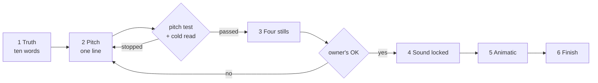

<div align="center">

# short-reel-method

**Test the idea of a short comedy reel before anything is drawn, voiced or animated.**

A Claude skill for 8–12 second reels (Instagram Reels, TikTok, Shorts), with a checker for the parts of a pitch that can be counted.


</div>

## Why this exists

A set of storyboards and a finished, voiced animatic passed every technical check: pacing, loudness, lip-sync, a
design review. The account's owner rejected all of it as random, with no punchline. Every check had measured
clarity and finish. None had measured whether the idea was funny.

This skill moves the test to the front, where an idea costs one line instead of a week.

| What went wrong | What the method does about it |
|---|---|
| The joke was a spoken line and a phone screen to read | The turn must be an event you can see, and it must read with the sound off |
| The author judged their own surprise | A fresh agent guesses what happens next; if it guesses the turn, the pitch is stopped |
| A yes to an idea in words did not survive the pictures | Four stills go to the owner before any voice or animation |
| A second and third twist were added to rescue it | Exactly one new event after the hook |
| A "tag a friend" caption | Refused: platforms show such reels to fewer people |

## The order of work



Each step has a gate, and nothing starts before the gate above it has passed. The full rules are in
[`SKILL.md`](SKILL.md).

## What the checker says

A pitch is a small Markdown file ([`pitch-template.md`](pitch-template.md)). This is the real output for the two
pitches in [`examples/`](examples):

```console
$ python3 scripts/pitch_check.py examples/overloaded.pitch.md
examples/overloaded.pitch.md
  FAIL hook is 11 words (at most 5): "When your flatmate sends you a payment request for the oil"
  FAIL truth is 17 words (at most 10)
  ok   length 9 s for a gag reel (8–12 s)
  FAIL turn lands at 8.5 s (by 7 s)
  ok   hook needs 3.8 s on screen, before the turn at 8.5 s
  FAIL 0.5 s left after the turn for the reaction (at least 1 s)
  FAIL 2 new events after the hook (exactly 1)
  FAIL the turn reads as a spoken line (a quote or "says"); a line is not an event
  FAIL the caption asks for engagement ("Tag"); platforms show such reels to fewer people
  note no "Why it had to be so" line: if you cannot write it, the turn is random
  note not checked here: whether the turn is a surprise (run the cold read)
one or more checks FAIL
```

```console
$ python3 scripts/pitch_check.py examples/coats.pitch.md
examples/coats.pitch.md
  ok   hook is 4 words (at most 5): "The library at 9:00"
  ok   truth is 10 words (at most 10)
  ok   length 10 s for a gag reel (8–12 s)
  ok   turn lands at 6 s (by 7 s)
  ok   hook needs 1.7 s on screen, before the turn at 6 s
  ok   4 s left after the turn for the reaction (at least 1 s)
  ok   1 new event after the hook (exactly 1)
  ok   the turn is written as a visible event, not a spoken line
  ok   the caption asks for nothing
  note not checked here: whether the turn is a surprise (run the cold read)
all counted checks pass
```

The second pitch passes every count, and the cold read still stopped it: the reader's answers are at the bottom
of [`examples/coats.pitch.md`](examples/coats.pitch.md). The checker counts. It does not know what is funny, and
it says so on its last line every time.

## Install

```bash
git clone https://github.com/DevCrazyCube/claude-skill-short-reel-method ~/.claude/skills/short-reel-method
```

Claude Code picks the skill up in its next session. For one project only, clone it into that project's
`.claude/skills/` instead. The checker needs Python 3.8 or newer and nothing else.

## Use

Ask for a reel idea, a pitch or a storyboard and the skill loads by itself; or name it:

```text
/short-reel-method six pitches about exam week for first-year students
```

What you get back is three to six pitches that passed, each with the cold reader's answers under it. A pick is
permission to draw that pitch's four stills and nothing more.

To use the checker without Claude:

```bash
cp pitch-template.md pitches/my-idea.md      # fill it in
python3 scripts/pitch_check.py pitches/*.md  # exit code 1 when a pitch fails
```

<details>
<summary><b>The pitch file</b></summary>

| Field | Meaning | Checked |
|---|---|---|
| `hook` | The text on screen at 0.0 s | 5 words or fewer; it needs 0.3 s a word plus 0.5 s on screen before the turn |
| `shape` | `gag` (default), `clock` or `story` | Sets the allowed length: 8–12 s, 6–30 s, 20–30 s |
| `length` | Seconds | Within the shape's range |
| `turn_at` | The second the turn lands | By 7 s for a gag reel; at least 1 s before the end |
| `events_after_hook` | New things that happen after the hook | Exactly 1 |
| `**Truth:**` | The lived moment | 10 words or fewer |
| `**Turn:**` | The visible event | No quotation marks, no "says" |
| `**Caption:**` | As it will be posted | No "tag", "send this to", "comment if", "follow for" and the like |
| `**Why it had to be so:**` | One sentence | A note when it is missing |

</details>

<details>
<summary><b>The eight questions of the pitch test</b></summary>

1. Can you tell it as "we see X, then Y" without quoting a spoken line?
2. Is the hook five words or fewer, and would a newcomer know the situation from it and the picture?
3. Is the turn a visible change?
4. Does the turn land by 7 s, or is a clock on screen from frame 1?
5. Is the turn free of any fact the hook did not set up?
6. If the moment is worn out: what does this version show that the earlier hundred did not?
7. Is there exactly one new event after the hook?
8. Put another character in the lead. Does the joke break?

One no, and the pitch is fixed or dropped.

</details>

<details>
<summary><b>What is established and what is a guess</b></summary>

One unusual thing per sketch, one game per character, the four-pose take and locking the sound before animating
are widely taught. That platforms rank down captions that ask for engagement is their own public statement.

The 2 s / 7 s / 12 s numbers and the hook's reading time are this method's inference and have not been measured
on an audience. Nor is it known whether an agent's cold read predicts a person's laugh: in its first trial it
stopped four of four pitches, each because the turn was among the reader's guesses. Change the numbers at the top
of `pitch_check.py` when your own account's figures say otherwise.

</details>

## Tests

```bash
python3 -m unittest discover -s tests -v
```

25 tests: the counting, the parsing, each check failing on its own, and the command line on the example files.

## Repo layout

```text
SKILL.md                 the method Claude follows
pitch-template.md        one pitch, in the format the checker reads
truths-template.md       the project's list of lived moments, and what to stay away from
scripts/pitch_check.py   the countable checks (standard library only)
examples/                a pitch that fails the counts, and one that passes them and fails the cold read
tests/                   unit tests for the checker
```

## Related

[`claude-skill-cold-read`](https://github.com/DevCrazyCube/claude-skill-cold-read) is the cold read as a skill of
its own, for anything a stranger has to understand. [`claude-skill-art-director-round`](https://github.com/DevCrazyCube/claude-skill-art-director-round)
is the design review of step 6. [`claude-skill-film-ear-eye`](https://github.com/DevCrazyCube/claude-skill-film-ear-eye)
measures the finished film's sound and motion.

## License

MIT. See [`LICENSE`](LICENSE).
